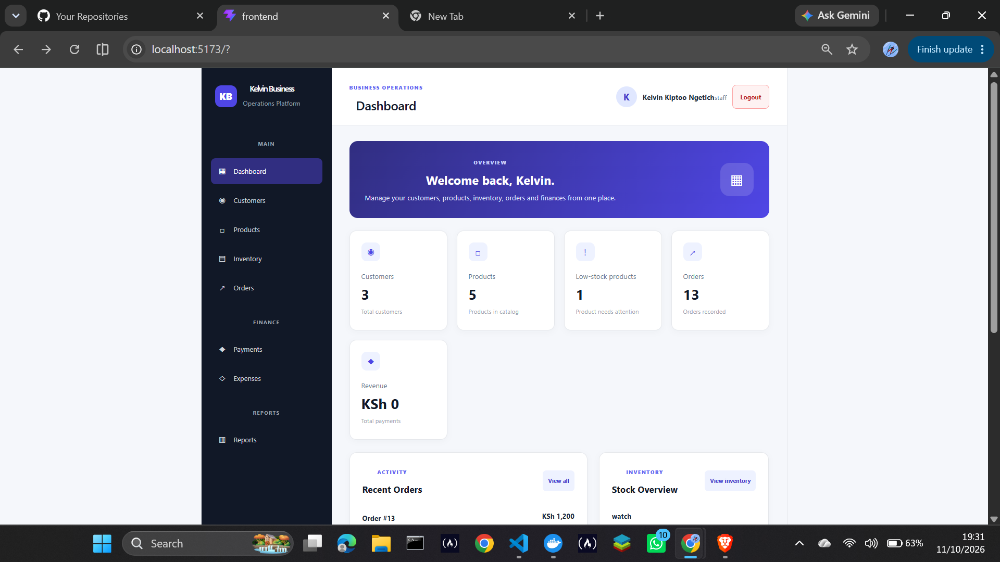
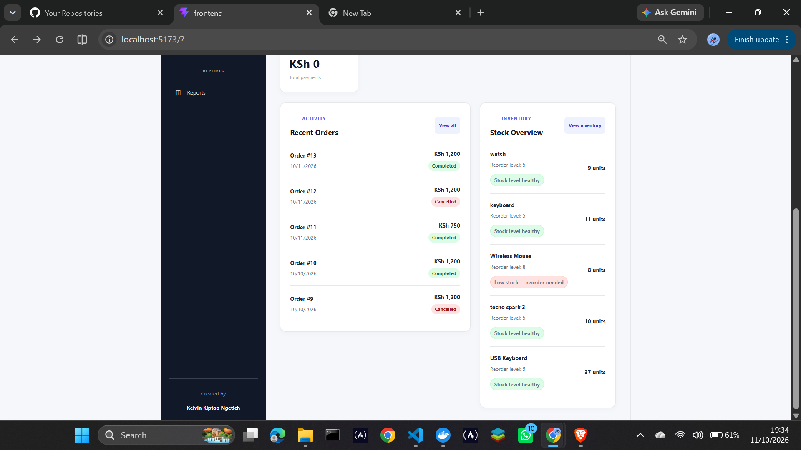
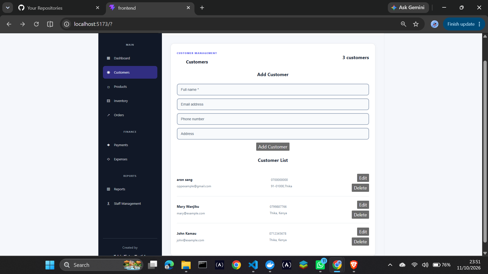
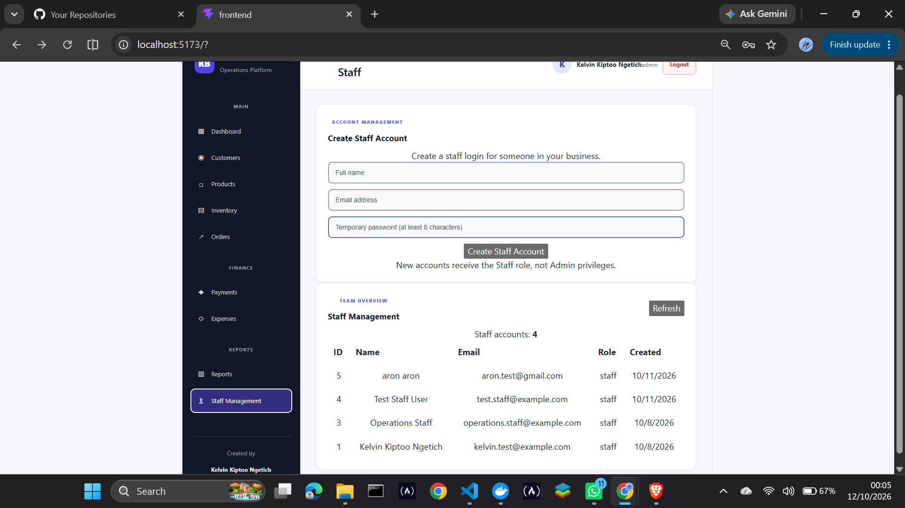
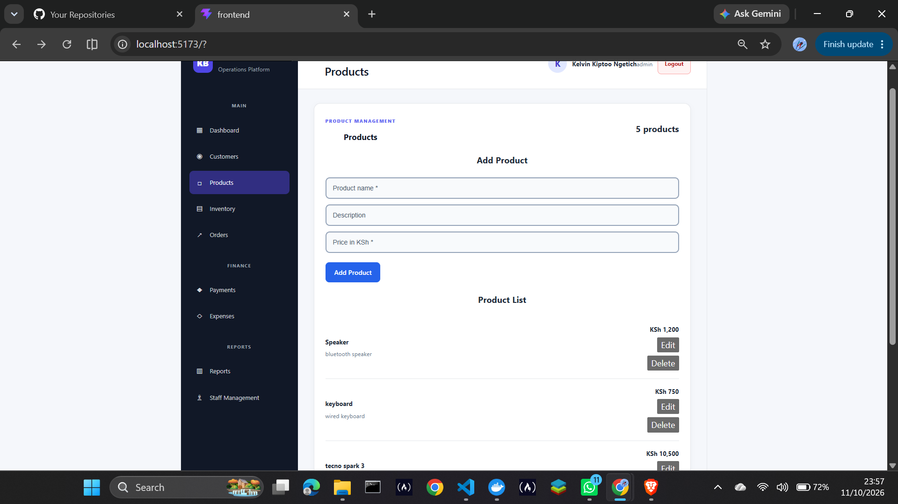
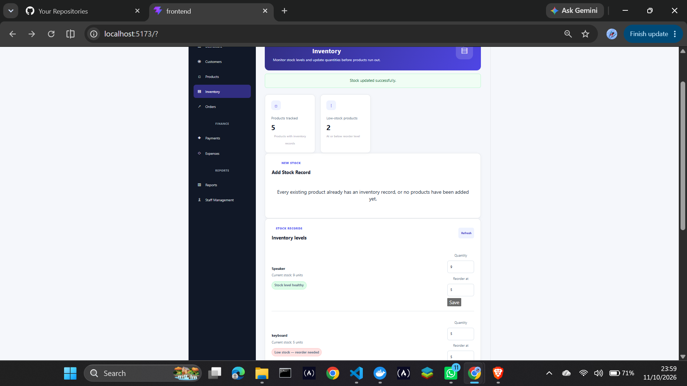
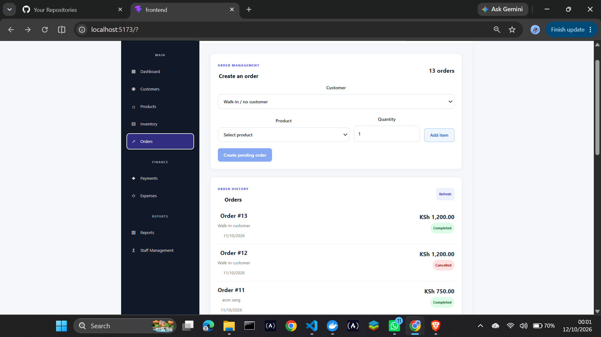
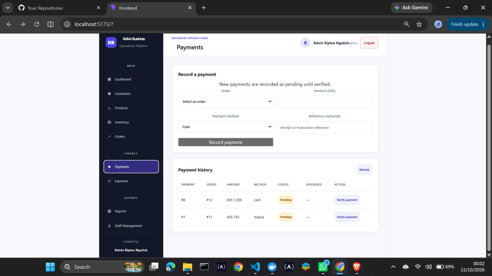
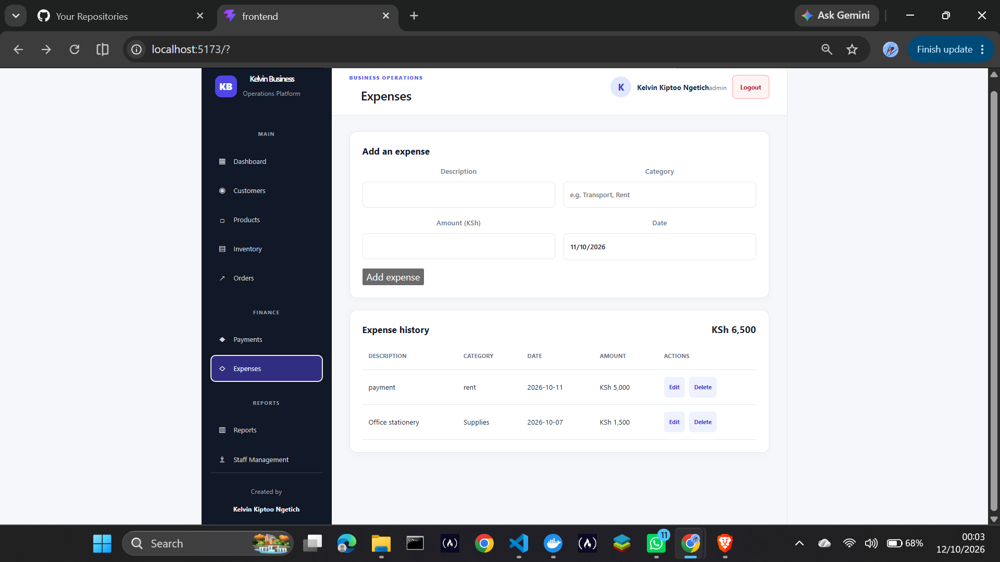
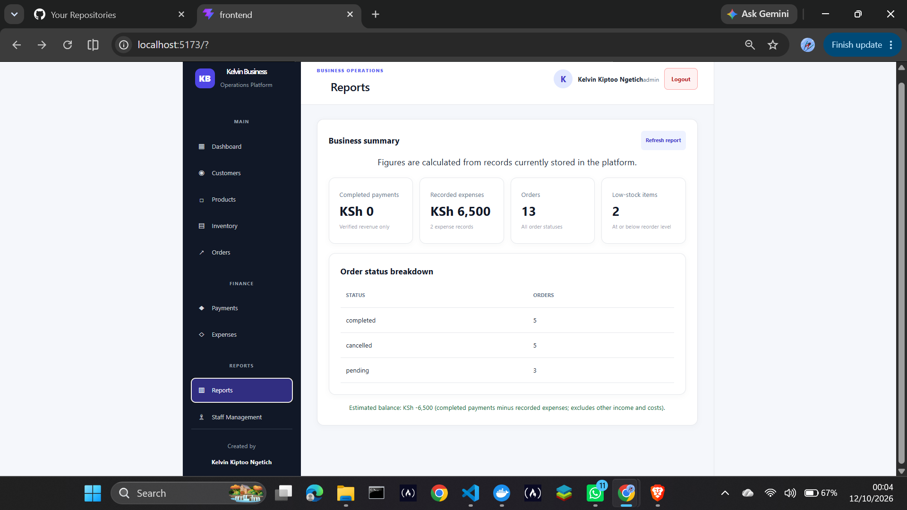

# Business Operations Platform

A web application for managing the main tasks involved in running a small business.

I built this project to practice what I learned in full-stack web development and apply it to something practical. I wanted to bring the frontend, backend, and database together in one application that can help manage everyday business tasks.

The application brings customer records, products, stock, orders, payments, expenses, and reports into one place.

## Why I Built It

Small businesses need to keep track of customers, products, stock levels, orders, payments, and expenses. I wanted to build an application that brings these tasks together while giving me practical experience connecting different parts of a full-stack application.

This project also gives me a way to demonstrate my development skills through a working application.

## What the Application Does

- **Dashboard:** Provides an overview of business activity.
- **Customers:** Stores customer records.
- **Products:** Stores product details and prices.
- **Inventory:** Tracks stock quantities and reorder levels.
- **Orders:** Manages orders, calculates totals, and checks stock when an order is confirmed.
- **Payments:** Manages payment records and payment verification permissions.
- **Expenses:** Records business expenses, categories, amounts, and dates.
- **Reports:** Provides business reporting information.
- **Login and permissions:** Controls access to features and business data.

## Technologies Used

**Frontend**
- React
- Vite
- JavaScript
- CSS

**Backend**
- Node.js
- Express.js
- REST API
- JSON Web Tokens (JWT)

**Database**
- PostgreSQL

**Development Tools**
- Git
- npm
- Visual Studio Code
- Docker-based development environment

## Screenshots

### Dashboard





### Customers and Staff





### Products and Inventory





### Orders and Payments





### Expenses and Reports





## Running the Project Locally

### Requirements

- Node.js and npm
- PostgreSQL
- Git

### 1. Get the source code

After the repository is published, clone it using:

```bash
git clone https://github.com/kelvindylan965-bot/business-operations-platform.git
cd business-operations-platform
```

### 2. Install backend dependencies

From the project root, run:

```bash
npm install
```

### 3. Configure PostgreSQL and environment variables

1. Install and start PostgreSQL.
2. Create a database for the application.
3. Apply the project's schema to that database from the project root:

   ```bash
   psql -U YOUR_POSTGRES_USER -d YOUR_DATABASE_NAME -f database/schema.sql
   ```

   Replace the placeholders with your PostgreSQL username and database name. The database must exist before you run this command.

4. Create a `.env` file in the project root and configure these variables:

   ```dotenv
   DB_HOST=localhost
   DB_PORT=5432
   DB_NAME=YOUR_DATABASE_NAME
   DB_USER=YOUR_POSTGRES_USER
   DB_PASSWORD=YOUR_POSTGRES_PASSWORD
   JWT_SECRET=REPLACE_WITH_A_LONG_RANDOM_SECRET
   ENABLE_ADMIN_BOOTSTRAP=false
   ADMIN_BOOTSTRAP_KEY=
   ```

   Adjust the database settings for your local PostgreSQL installation. Generate a strong, unique JWT secret. Keep `ENABLE_ADMIN_BOOTSTRAP=false` for normal use. Only enable admin bootstrap deliberately for initial setup, with a strong `ADMIN_BOOTSTRAP_KEY`, then disable it again.

The schema creates tables but does not create a business record or administrator. Before using admin bootstrap, create a business record and note its ID:

```sql
INSERT INTO businesses (name)
VALUES ('Your Business Name')
RETURNING id;
```

Use the returned ID as `business_id` when creating the administrator. Keep bootstrap disabled during normal use.

**Security:** Never commit `.env` or publish database passwords, JWT secrets, or admin bootstrap keys. Keep your local credentials private.

### 4. Start the backend

From the project root, run:

```bash
npm run dev
```

### 5. Start the frontend

Open a second terminal and run:

```bash
cd frontend
npm install
npm run dev
```

Open the local address printed by Vite in your browser.

The database and environment configuration must be set up for your own computer before the application can run.

## What I Learned

Building this project gave me practical experience connecting a frontend to a backend, working with PostgreSQL, creating API endpoints, handling authentication and permissions, validating user input, and managing related business records.

It also helped me understand how important it is for different features to work together and for the underlying data to remain consistent.

## Author

**Kelvin Kiptoo Ngetich**

GitHub: [kelvindylan965-bot](https://github.com/kelvindylan965-bot)
